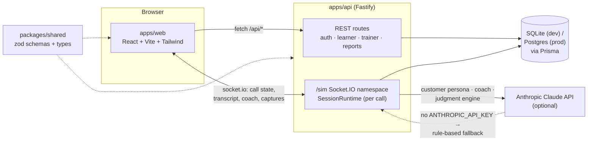

# Parishodh

A live sales-call simulation platform: a learner takes a simulated phone call from an AI customer, with a "Judgment Engine" scoring them live and a coach suggesting what to say next. See [CLAUDE.md](./CLAUDE.md) for the full product spec and engineering rules.

## Architecture



Three AI roles drive a live call — **Customer Persona**, **Response Coach**, and the **Judgment Engine** (`apps/api/src/sim/{customerPersona,coach,judgment}.ts`) — each with its own model config (see [Environment variables](#environment-variables)) and a rule-based fallback so the whole pipeline works with no `ANTHROPIC_API_KEY` configured. A fourth, one-off use (trainer scenario authoring) lives in `apps/api/src/trainer/scenarioGenerator.ts`.

A scenario's `mode` picks the call's engine:

- **SCRIPTED** — replays a pre-authored golden transcript (`apps/api/prisma/seed.ts`'s Mahindra EV 9S scenario), no AI calls. This is the one `?autoplay=1` drives end-to-end for demos and the scripted-flow e2e test.
- **GUIDED** — live AI customer + coach suggestions; verbatim-reading is penalized in the final score (CLAUDE.md "Modes").
- **ASSESSMENT** — live AI customer, no coach suggestions — the learner speaks freely.

## Quick start

```bash
pnpm install
cp apps/api/.env.example apps/api/.env
pnpm --filter @parishodh/api run db:migrate
pnpm --filter @parishodh/api run db:seed
pnpm dev
```

- Web: http://localhost:5173
- API: http://localhost:4000 (health check at `/api/health`)

Demo accounts (seeded, password `demo1234` for both):

| Role    | Email              | Notes                                                              |
| ------- | ------------------ | -------------------------------------------------------------------- |
| Learner | `aarav@demo.in`    | Has a completed course + assessment and one assigned SCRIPTED live task (Mahindra EV 9S) |
| Trainer | `trainer@demo.in`  | Can generate new scenarios, assign them, and review reports          |

Leave `ANTHROPIC_API_KEY` unset in `apps/api/.env` to run entirely on rule-based fallbacks (no API costs) — everything, including GUIDED/ASSESSMENT live calls, still works; the customer/coach/judgment logic is just template-driven instead of AI-generated. Set it (and `AI_MODEL`) to exercise the real Claude-backed pipeline.

### Trying the demo call

1. Log in as the learner — the dashboard shows one assigned live task, the seeded Mahindra EV 9S (SCRIPTED) scenario. Click **Start Simulation** to play it yourself, or append `?autoplay=1` to the resulting `/simulation/<sessionId>` URL to watch the whole golden-transcript call play itself end-to-end with no input.
2. As a trainer, use **Scenarios → Generate with AI** (or leave `ANTHROPIC_API_KEY` unset for a template-based scenario), **Assign** it to the learner, then **Test call** to try a live GUIDED call yourself.

## Environment variables

Full list with defaults and comments: [`apps/api/.env.example`](./apps/api/.env.example). Highlights:

| Variable | Purpose |
| --- | --- |
| `DATABASE_URL` | Prisma connection string (SQLite file path in dev) |
| `JWT_SECRET` | Signs auth tokens — change it for anything beyond local dev |
| `ANTHROPIC_API_KEY`, `AI_MODEL` | Enable real AI calls; unset = rule-based fallback everywhere |
| `AI_MODEL_CUSTOMER` / `_COACH` / `_JUDGMENT` / `_TRAINER` | Per-role model overrides (cost control) — each falls back to `AI_MODEL` |
| `AI_CALL_TIMEOUT_MS` | Per-call timeout before falling back (default 15s) |
| `SCRIPTED_CHARS_PER_SEC`, `SCRIPTED_THINK_MS`, `RINGING_DELAY_MIN_MS`, `RINGING_DELAY_MAX_MS` | SCRIPTED-mode replay pacing — realistic by default, overridden fast in tests |
| `MIN_LEARNER_TURN_INTERVAL_MS` | Per-socket rate-limit floor between learner turns |

For `docker compose up`, see the root [`.env.example`](./.env.example) instead (forwarded through to the `api` container).

## Scripts

| Command | What it does |
| --- | --- |
| `pnpm dev` | Builds `packages/shared`, then runs the web app and API together |
| `pnpm build` | Typechecks and builds all workspaces (shared first) |
| `pnpm test` | Runs all workspace unit/integration test suites (shared + api; web has none yet) |
| `pnpm run test:e2e` | Runs the Playwright e2e suite — **stop any running `pnpm dev` first** (it starts its own dev servers against a dedicated throwaway DB; see [Testing](#testing)) |
| `pnpm lint` | Lints all workspaces |
| `pnpm db:seed` | Seeds the API's database with demo users/courses/scenarios |

## Testing

- **Unit/integration** (`pnpm test`): `packages/shared` covers the adherence-matching algorithm and socket payload schemas; `apps/api` covers the state machine, rule-based judgment, verdict bands/capability scoring, and a full scripted-call integration test over real sockets.
- **End-to-end** (`pnpm run test:e2e`, Playwright): covers the SCRIPTED autoplay flow end-to-end to a results report, and an ASSESSMENT-mode call confirming no AI-suggested line is ever offered. It starts its own API + web dev servers against a dedicated `apps/api/prisma/e2e.db` (migrated and seeded fresh by `e2e/global-setup.ts` on every run) — **stop any manually-running `pnpm dev` first**, since both would otherwise fight over ports 4000/5173.

## Deployment (Docker)

```bash
cp .env.example .env   # fill in JWT_SECRET, ANTHROPIC_API_KEY etc. as needed
docker compose up -d --build
docker compose exec api ./node_modules/.bin/tsx prisma/seed.ts   # once, on first bring-up
```

- Web: http://localhost:8080 (nginx, reverse-proxying `/api` and `/socket.io` to the `api` service — see `apps/web/nginx.conf`)
- API: http://localhost:4000
- Postgres: internal only, via the `db` service and `apps/api/prisma/schema.postgres.prisma` (same models as the dev SQLite schema, `prisma db push` on every start rather than a migration history — see that file's header comment for why)

> **Note:** Docker isn't available in the environment this project was built in, so the Dockerfiles/compose setup above is written and internally verified (schema validated, each build stage's logic reasoned through and cross-checked) but has **not** been run end-to-end with `docker compose up`. Everything else in this README — the dev setup, unit tests, and e2e tests — has been run and passes.

## CI

`.github/workflows/ci.yml` runs on every push/PR: build + lint + unit/integration tests (plus a Postgres schema validation) in one job, and the Playwright e2e suite in a second.

## Structure

```
apps/web       React + Vite + TypeScript + Tailwind frontend
apps/api       Fastify + Socket.IO + Prisma backend
packages/shared  Shared TypeScript types and zod schemas (built before anything consumes it — see pnpm dev/build/test)
e2e/           Playwright end-to-end tests
```
